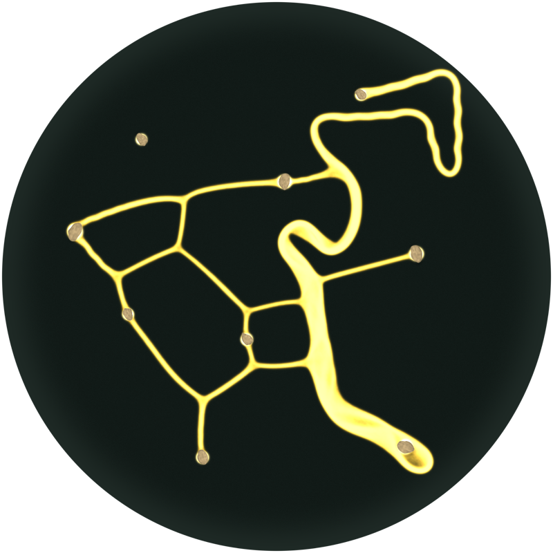
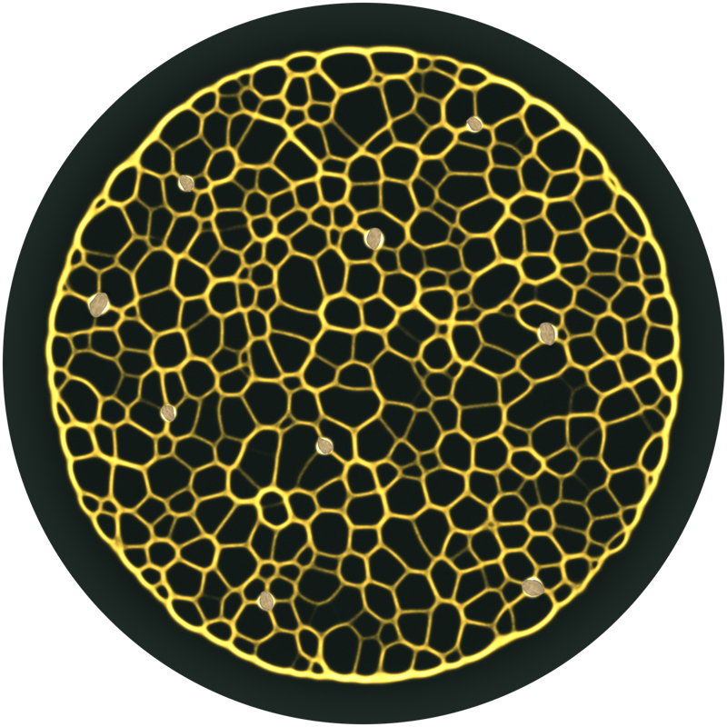
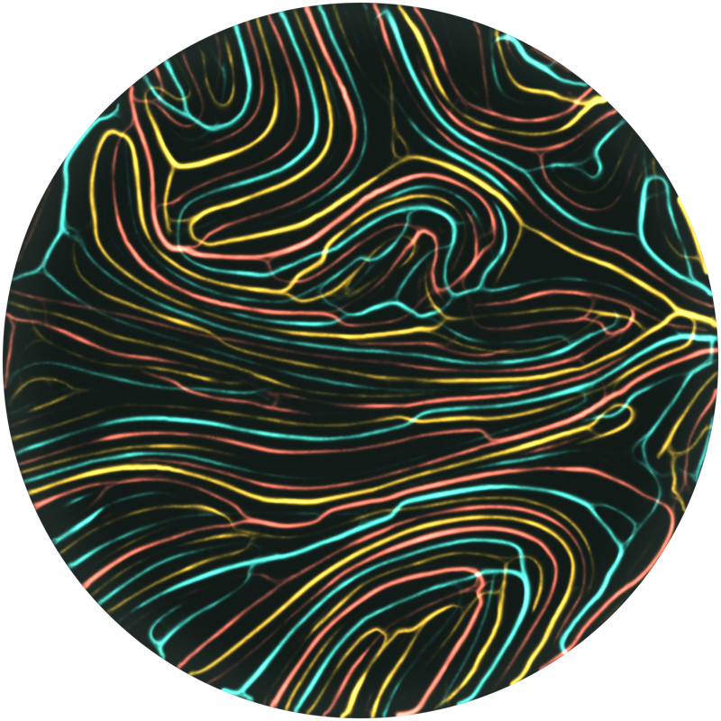
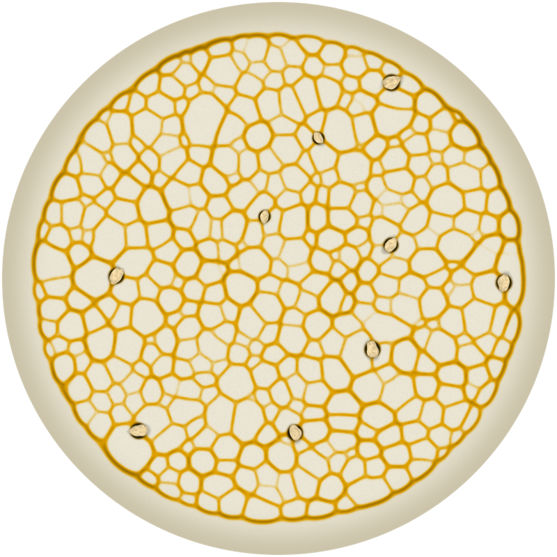

# Physarum Plate

<p align="center">
  
</p>

A slime-mold simulation that runs in the browser. About half a million agents grow transport networks on your GPU, and each one follows a single local rule:

1. Sense the trail at three points just ahead (front, left, right).
2. Turn toward the strongest reading.
3. Step forward and deposit a little trail.

No agent sees further than its three sensors, and none of them knows a network exists. The trail fades a little every step, so a path survives only while agents keep using it. Biologists call this kind of coordination through traces in the environment *stigmergy*.

The rule comes from the agent model Jeff Jones proposed in 2010 for the networks grown by *Physarum polycephalum*, a single-celled slime mold with no nervous system.

## Run it

It's one HTML file with no build step and no dependencies. Open `index.html` in a recent Chrome, Edge, Firefox or Safari. It needs WebGL2 and floating-point render targets, which almost every current desktop and phone has.

If your browser blocks pages opened from disk, serve the folder instead:

```bash
python3 -m http.server 8000
```

Then visit http://localhost:8000. Fonts load from Google Fonts. Without a connection the page falls back to system fonts.

## What you can do

| Control | What it does |
| --- | --- |
| **Presets** | Six parameter sets (below). Switching morphs the live plate instead of restarting it. |
| **Oat flake** tool | Click or tap to drop food. Click a flake to remove it. |
| **Light** tool | Drag to shine light. Agents avoid lit areas and can't cross bright ones, so you can draw walls. |
| **Erase** tool | Wipes light and flakes. |
| **Sliders** | Sensor angle (SA), turn angle (RA), sensor distance (SO), step size (SS), wobble, evaporation, diffusion and saturation, all live. |
| **Mutate** | Jumps to random nearby parameters. |
| **Start / Agents / Speed** | Seeding pattern (scattered, central inoculum, ring), population (131k to 1M) and steps per frame. |

Keyboard: <kbd>Space</kbd> pauses, <kbd>R</kbd> re-seeds, <kbd>M</kbd> mutates.

The page follows your system's light or dark setting. Light mode looks like a lit agar plate, dark mode like darkfield microscopy.

## Presets

| | SA | RA | SO | SS | Saturation | What happens |
| --- | --- | --- | --- | --- | --- | --- |
| **Foraging** | 22.5° | 45° | 9 | 1.0 | 3 | Jones's classic numbers. A fine mesh tightens over a minute or two until mostly tubes between the oat flakes remain. |
| **Lattice** | 60° | 18° | 12 | 1.0 | 4 | A fine, steady mesh that fills the dish. |
| **Foam** | 80° | 25° | 25 | 1.5 | 6 | Large cells with thick doubled walls. |
| **Labyrinth** | 45° | 80° | 4 | 1.0 | 6 | Wriggling walls. From a fresh seed, a maze of worm-like corridors. |
| **Strands** | 22.5° | 45° | 9 | 1.0 | off | The whole population piles into a few wandering strands. |
| **Marbling** | 30° | 45° | 12 | 1.2 | 3 | Three strains that follow their own trail and avoid the others' comb into interleaved bands. |

Distances are in grid cells on a 1024 × 1024 plate.

<p align="center">
  
  
  
</p>
<p align="center"><sub>Left to right: the Foraging mesh before it tightens, Marbling, and the light theme.</sub></p>

## How it works

Everything runs on the GPU in WebGL2, in four passes per simulation step:

1. **Sense and move.** A vertex shader reads each agent's position and heading, samples the trail texture at its three sensors, turns, and steps. Transform feedback writes the new state into a second buffer (ping-pong), so positions keep full 32-bit precision.
2. **Deposit.** The agents are drawn as one-pixel points into an `RGBA16F` trail texture with additive blending. Each strain writes to its own color channel.
3. **Diffuse and evaporate.** A fragment shader applies a 3 × 3 blur, multiplies by the evaporation factor, and lets oat flakes emit into the trail.
4. **Render.** The trail is tone-mapped and colored for the current theme, then the oat flakes are drawn over it. The light mode multiplies color like pigment on agar. The dark mode adds it like light.

### One change from Jones's model

In the original model only one agent may occupy a grid cell, which keeps the population spread out. That's awkward to do on a GPU. Without it, every agent ends up in the same few strands (the Strands preset shows this). This version clamps how strong a trail can read instead: past the **saturation** level, two trails look equally attractive. Agents on a saturated path stop competing for its center, and the network stays open.

Oat flakes emit attractant into the same trail map, so they act as permanent nodes the network contracts onto. Light lives in a separate texture that agents treat as both a strong repellent and a wall.

## References

- T. Nakagaki, H. Yamada & Á. Tóth, "Maze-solving by an amoeboid organism", *Nature* 407, 470 (2000). [doi:10.1038/35035159](https://doi.org/10.1038/35035159)
- A. Tero et al., "Rules for biologically inspired adaptive network design", *Science* 327, 439–442 (2010). [doi:10.1126/science.1177894](https://doi.org/10.1126/science.1177894)
- J. Jones, "Characteristics of pattern formation and evolution in approximations of Physarum transport networks", *Artificial Life* 16(2), 127–153 (2010). [doi:10.1162/artl.2010.16.2.16202](https://doi.org/10.1162/artl.2010.16.2.16202)

## License

[MIT](LICENSE)
